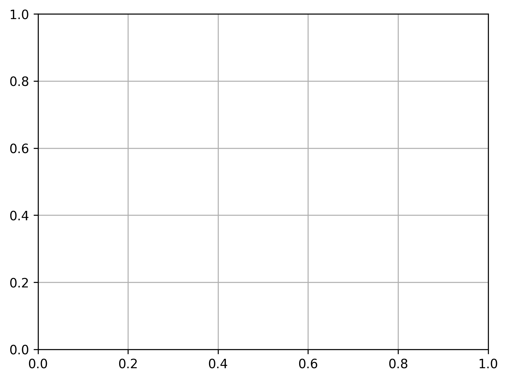

# Logistic Regression Classification

## Project Overview

This project implements a Logistic Regression classification
model using Python and Scikit-learn.

The model predicts binary class labels and evaluates
performance using different classification metrics.

## Technologies Used

- Python
- NumPy
- Pandas
- Matplotlib
- Scikit-learn

## Machine Learning Workflow

1. Load dataset
2. Select independent and dependent variables
3. Split data into training and testing sets
4. Apply StandardScaler
5. Train Logistic Regression model
6. Predict test results
7. Evaluate model performance

## Evaluation Metrics

- Confusion Matrix
- Accuracy Score
- Precision
- Recall
- F1 Score
- ROC Curve
- AUC Score

## Installation

```bash
pip install -r requirements.txt
```

## Run the project

```bash
python logistic_regression.py
```

## ROC Curve



## Author

Yashwanth
